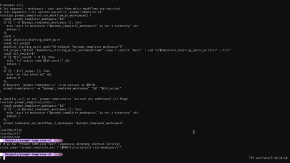

# `README.md`

`prompt-templater` is a proof-of-concept CLI template rendering util, that prefills clipboard with rendered contents. This is useful for having accessible large chunks of text that need relatively few customizations, in relatively few keystrokes. Simply think of the use-case as set of customizable shortcuts ready to paste, instead of typing words.

- [How it works?](#how-it-works)
- [How to setup?](#how-to-setup)
- [Motivation](#motivation)
- [Feature support](#feature-support)
- [Roadmap](#roadmap)
- [Anyways...](#anyways)

## How it works?


After running the command, you should automatically have following contents in your clipboard


### `prompt-templater` under the hood

`prompt-templater` works by connecting [`handlebars`](https://handlebarsjs.com/) templates with concept of workflows. Workflows are simple CLI programs / series of prompts generated from JSON / YAML config files, on top of [`inquirer` library](https://www.npmjs.com/package/inquirer). These prompts populate variables rendered by `handlebars` template.

For following command

```sh
./bin/prompt-templater-v1 -w "$PWD/fixtures/unit-test-workspace" workflows/test-workflow.yml
```

example template (available [here](./fixtures/unit-test-workspace/templates/test-template-basic.hbs))

```hbs
passed value from workflow: {{selectStep}}
```

along with example workflow (available [here](./fixtures/unit-test-workspace/workflows/test-workflow.yml))

```yaml
# Workflow file references template
# path can be relative, assuming both workflow and template are located in same workspace
templateFile: templates/test-template-basic.hbs
steps:
  - type: select
    # Defines variable name `selectStep`, that will contain picked value out of `literalValue1..3`
    id: selectStep
    message: pick an option
    valueType: string
    choices:
      type: literal
      values:
        - literalValue1
        - literalValue2
        - literalValue3
```

### Practical recommendations to make this an efficient tool

or if you want to try setting it up right away, skip to ["setup guide"](#how-to-setup)

#### recommendation \#1 - [`fzf`](https://github.com/junegunn/fzf)

Since workflow is the sole entrypoint of `prompt-templater`, that also references template to render, clearly you don't want to type workflow everytime you want to run this. [`fzf`](https://github.com/junegunn/fzf) fuzzy finder is a good tool for picking workflow to run.

You can assemble a simple workflow picker



using following snippet

```sh
# Check if executables on which bash function depends are present
function check_dependencies() {
  if ! which "find"; then
    echo "\"find\" dependency not found, install via your package manager" >&2
    return 1
  fi
  if ! which "fzf"; then
    echo "\"fzf\" dependency not found, install via your package manager" >&2
    return 1
  fi
  if ! which "sed"; then
    echo "\"sed\" dependency not found, install via your package manager" >&2
    return 1
  fi
}

check_dependencies
# Generic util
# 1st argument = workspace - root path from which workflows are searched
# rest arguments = CLI options passed to `prompt-templater-v1`
function prompt_templater_run_workflow_in_workspace() {
  local prompt_templater_workspace="$1"
  if [[ ! -d $prompt_templater_workspace ]]; then
    echo "path to workspace \"$prompt_templater_workspace\" is not a directory" >&2
    return 1
  fi
  shift 1
  local absolute_starting_point_path
  local fzf_output
  absolute_starting_point_path="$(realpath "$prompt_templater_workspace")"
  fzf_output="$(find "$absolute_starting_point_path/workflows" -type f -printf "%p\n"  | sed "s|${absolute_starting_point_path}/||" | fzf)"
  local fzf_result=$?
  if [[ $fzf_result != 0 ]]; then
    echo "fzf status code $fzf_result" >&2
    return 1
  fi
  if [[ ! $fzf_output ]]; then
    echo "no file selected" >&2
    return 0
  fi
  # Requires `prompt-templater-v1` to be present in $PATH
  prompt-templater-v1 -w "$prompt_templater_workspace" "$@" "$fzf_output"
}

# Specific util to run `prompt-templater-v1` without any additional CLI flags
function prompt_templater_run() {
  local prompt_templater_workspace="$1"
  if [[ ! -d $prompt_templater_workspace ]]; then
    echo "path to workspace \"$prompt_templater_workspace\" is not a directory" >&2
    return 1
  fi
  prompt_templater_run_workflow_in_workspace "$prompt_templater_workspace"
}
```

and test with following one-liner in root folder of cloned repository

```sh
# To resolve `prompt-templater-v1` executable path
PATH="$PATH:$PWD/bin"
prompt_templater_run "$PWD/fixtures/unit-test-workspace"
```

#### recommendation \#2 - shell alias

[`alias`](https://en.wikipedia.org/wiki/Alias_%28command%29) is strongly recommended as well; for example


using following snippet

```sh
# as for "Prompt TeMPlater Test" (uppercase denoting shortcut letters)
alias ptmpt="prompt_templater_run \"\$PWD/fixtures/unit-test-workspace\""
```

Motivation for using `alias` is ease of workspace switching rather than typing speed. As you could see in previous examples

```sh
# workspace passed as `-w` argument
prompt-templater-v1 -w "$prompt_templater_workspace" "$@" "$fzf_output"
```

Workspaces are passed as `-w` argument to `prompt-templater` executable. Workspace option `-w` is a required option. Furthermore each template and workflow belongs under a workspace.

Workspaces are are folders with following structure

```txt
.
├── templates
├── terms
└── workflows

4 directories
```

Workspace folders are considered resource containers from which resources (workflows, templates + potentially more) can be identified using relative path.


command to create workspace = TBD

For now a simple `mkdir` will suffice, as there are no further restriction on workspace, other than expecting mentioned subfolders

```sh
mkdir templates terms workflows
```

or

```sh
mkdir -p workspace/templates workspace/terms workspace/workflows
```

Organization of workspaces is subject to user decisions; workspaces can be containers per-project, or containers per-use-case, whether it's for `bash` snippets that you didn't have time to put together into maintained functionality / viable scripts,, but you need to keep it somewhere as a workaround, or for prompt crafting, for whatever is not skillified in your project using `AGENTS.md` for some reason

### Use with AI

The obvious use-case for `prompt-templater` is LLM prompt crafting, which is the main motivation why this utility came to existence in the first place.

Procedural thinking in codebases is largely achieved using LLM Skills, however `/skillify`-ing sessions / defining skill doesn't really fill the gap towards one-shotting UX with LLMs. Use of skills still requires articulating a lot of supplementary prompt text. Fuzzy finder with a few keypresses, gets closer to the almost-deterministic feel of getting things done with AI.

## How to setup?

<span style="color: #FFD700;">⚠️</span> Heavy PoC - naturally untested outside of my Linux workstation

### Dependencies

- [`bun`](https://bun.sh/)
- [`fzf`](https://github.com/junegunn/fzf) (recommended)

### 1. `git clone`

```sh
# Check if executables on which bash function depends are present
function check_dependencies() {
  if ! which "bun"; then
    echo "\"bun\" dependency not found, install" >&2
    return 1
  fi
  if ! which "find"; then
    echo "\"find\" dependency not found, install via your package manager" >&2
    return 1
  fi
  if ! which "fzf"; then
    echo "\"fzf\" dependency not found, install via your package manager" >&2
    return 1
  fi
  if ! which "sed"; then
    echo "\"sed\" dependency not found, install via your package manager" >&2
    return 1
  fi
}

function setup() {
  # Check deps and fail if there's a dependency missing
  check_dependencies || return $?
  git clone "https://codeberg.org/koniferous22/prompt-templater-v1.git"
}

setup
```

### 2. Configure shell utils

Define `prompt-templater` related functions in your `.bashrc` / `.zshrc`

Note for `nushell` users - sadly didn't have time to write `nushell` equivalent :(

```sh
# Generic util
# 1st argument = workspace - root path from which workflows are searched
# rest arguments = CLI options passed to `prompt-templater-v1`
function prompt_templater_run_workflow_in_workspace() {
  local prompt_templater_workspace="$1"
  if [[ ! -d $prompt_templater_workspace ]]; then
    echo "path to workspace \"$prompt_templater_workspace\" is not a directory" >&2
    return 1
  fi
  shift 1
  local absolute_starting_point_path
  local fzf_output
  absolute_starting_point_path="$(realpath "$prompt_templater_workspace")"
  fzf_output="$(find "$absolute_starting_point_path/workflows" -type f -printf "%p\n"  | sed "s|${absolute_starting_point_path}/||" | fzf)"
  local fzf_result=$?
  if [[ $fzf_result != 0 ]]; then
    echo "fzf status code $fzf_result" >&2
    return 1
  fi
  if [[ ! $fzf_output ]]; then
    echo "no file selected" >&2
    return 0
  fi
  # Requires `prompt-templater-v1` to be present in $PATH
  prompt-templater-v1 -w "$prompt_templater_workspace" "$@" "$fzf_output"
}

# Specific util to run `prompt-templater-v1` without any additional CLI flags
function prompt_templater_run() {
  local prompt_templater_workspace="$1"
  if [[ ! -d $prompt_templater_workspace ]]; then
    echo "path to workspace \"$prompt_templater_workspace\" is not a directory" >&2
    return 1
  fi
  prompt_templater_run_workflow_in_workspace "$prompt_templater_workspace"
}

# Runs `prompt-templater-v1` with additional "-u" flag
function prompt_templater_run_unsafe() {
  local prompt_templater_workspace="$1"
  if [[ ! -d $prompt_templater_workspace ]]; then
    echo "path to workspace \"$prompt_templater_workspace\" is not a directory" >&2
    return 1
  fi
  prompt_templater_run_workflow_in_workspace "$prompt_templater_workspace" "-u"
}
```

### 3. Create workspaces in your FS

```sh
mkdir templates terms workflows
```

or (<span style="color: #FFD700;">⚠️</span> make sure to reconfigure)

```sh
mkdir -p /my/path/to/prompt-templater/workspace1/templates /my/path/to/prompt-templater/workspace1/terms /my/path/to/prompt-templater/workspace1/workflows
```

### 4. Define workspace env variables and `alias`es

#### workspace env variables

<span style="color: #FFD700;">⚠️</span> make sure to reconfigure

```sh
# either `~/.bash_profile`, or `.zshenv
PROMPT_TEMPLATER_WORKSPACE1=/my/path/to/prompt-templater/workspace1
PROMPT_TEMPLATER_WORKSPACE2=/my/path/to/prompt-templater/workspace2
```

#### `alias`es

```sh
# either `~/.bashrc`, or `.zshrc
ptmpw1="prompt_templater_run \"\$PROMPT_TEMPLATER_WORKSPACE1\""
ptmpw2="prompt_templater_run \"\$PROMPT_TEMPLATER_WORKSPACE2\""
# unsafe variants
ptmpwu1="prompt_templater_run_unsafe \"\$PROMPT_TEMPLATER_WORKSPACE1\""
ptmpwu2="prompt_templater_run_unsafe \"\$PROMPT_TEMPLATER_WORKSPACE2\""
```

## Motivation

[(skip to shorter version)](#shorter-version)

### Longer version (goes a off tangent, so naturally don't read it, unless you have no other choice)

I'm a believer in [DRY](https://en.wikipedia.org/wiki/Don%27t_repeat_yourself) as a concept applicable to human life. Surely, the concept of DRY originates from engineering, however from personal engineering experience, I've seen many instances unorganized duplicate spaghetti code, that served its purpose well, assuming we discount potential invisible security issues, that are byproduct of poor design choices. But I would argue that there's also a strange applicability of DRY principle to human life - i.e. not repeating yourself.

If we were to serialize human life as sequence / stream of human actions, then it would make sense at very least not to repeat actions that human, or frankly any independent agent with free will, would consider a mistake. Concept of mistake should be understood without official definition, as the whole idea expressed so far relies on preassumption independent human agency, where mistake is naturally subjectively defined by each human / each independent agent. But to give the reader a demonstrative example, addictions are typically mistakes that addicted individual repeats. Surely act of addictive routine with negative impact can be temporarily euphoric, at least in the present moment, when addicted individual performs the rite; clearly the addicted person has to get the daily dose of dopamine somehow. But addictions have tendency to be retrospectively perceived as mistakes, at least by the people whose lives don't get fully consumed by addictions. Formally addictions can be modelled as [positive feedback loops](https://en.wikipedia.org/wiki/Positive_feedback), that can be repeated sometimes consciously or unconsciously through [adapted human behaviour](https://en.wikipedia.org/wiki/Neuroplasticity). In either of cases the concept of a repetition loop is well formalized.

Furthermore, there are even more popular variants of repetition principles and principle of distinction between desired and undesired actions. For instance Jeff Bezos' "[regret-minimization framework](https://en.wikipedia.org/wiki/Jeff_Bezos)" touches this area. Or even more pop-culture friendly [Far Cry 3 villain monologue](https://en.wikipedia.org/wiki/Vaas_Montenegro) for the hip gamers out there. The Far Cry 3 villain monologue is about "definition of insanity", where the villain outlines the concept of "insanity" as repeating same thing over and expecting different results. Without having to delve too deep into area of video games, it should be clear that human repetition is generally understood concept, through various demonstrations.

So for humans it's not really about "not repeating" ourselves. That should be the primary objective an individual autistically focuses on. But we should have respect towards the things we constantly repeat, especially if you take into consideration constantly [changing nature of our minds](https://en.wikipedia.org/wiki/Neuroplasticity). There should be fear of never-ending repetition, because naturally it's scary to think of a scenario, where human psyche has to be subjected to never-ending readaption through repeating of certain activity. There's a philosophical quote, that bears some similarity to "Don't repeat yourself" principle, but is expressed more in human words. "No man ever enters the same river twice" - a statement said by greek philosopher [Heraclitus](https://en.wikipedia.org/wiki/Heraclitus) (according to an AI summary). Other quote by Heraclitus, is "Everything flows". Clearly the nature of statements, attributed to Heraclitus is about constantly-changing, chaotic nature of existence. Religions acknowledge these ideas unknown, ideologues define ideologies to articulate at least some naive interpretation of what's not known, scientist observe, examine and try to understand the mysteries around and come to hopefully objective interpretations of the world, or at very least they tend to aspire towards that goal, transhumanist thinkers call the mysterious nature of existence "entropy. Clearly there are many perceptions, of universe.

While world seems to be unexplored, constant change is part of existence, it's a strange thing to accept that human undergoes "[ego deaths](en.wikipedia.org/wiki/Ego_death)" during course of lifetime. We are subjected to changing ourselves, rewiring ourselves, re-configuring ourselves, especially in moments when it suits us the least. Abandoning our agenda, and starting from scratch, almost feeling like a video game respawn. But to think that such repetition can go on autopilot; i.e. that humans are reduced to compulsively repeat certain actions, is a scary thought. Or from engineering perspective, it should be a scary thought that human existence can be trivialized into a `for` loop, or a `while` loop, where human becomes a subject of repetition. And it's scary to imagine the degree to which individuals are eroded from who they really are.

So with the theathre-like explanation of evils of repetition taken care of.. TLDR, I got tired from typing prompts. LLM skills leverage a lot of stuff, and should be maxxed, however skills do not really come close to oneshotting things as you usually have to type a lot of complementary text. Or achieve the result clumsily through conversation containing 20 disjointed request, in hopes of AI / clanker getting whatever the end user desires magically right. Typing words overall sucks ass, so the motivation for this mini-tool was to have quick and efficient prompt-crafting tool, to get rid of typing words, eventually overall. Things that are automated, or are supposed to be automated, should take minimum of human attention. That for me (personally) was the whole purpose of camputors, and automation as a whole. Now that camputors are capable of inferrence by themselves and natural language has quasi become a programming language, humans shouldn't be providing any justifications to AI / robots / clankers (etc). Clipboard makes much better interface, than typing basically anything.

Naturally all of us can stare hours into claude code or chatgpt textareas. While staring gets work done, simply think of this approach as a parallel route, or at least aspiration, where in ideal world you don't have to think, you just rely on clipboard and feed the AI whatever you've got already prepared, to get the outcome. Frankly speaking, this repository is not really about code, but more about the idea, as I'm sure anyone can probably vibe-code better variant of this utility these days.

Note - if the yapping was not understandable, try copying the text to AI, to explain you what the fuck I was trying to tell you metaphorically. If that doesn't help, naturally I give up.

### Shorter version

take a look at these two images, and think which one of these two interfaces is faster, more interactive and most importantly doesn't require unreasonable amount of mental gymnastics / instructions to achieve the result

<p align="center">
  
  &nbsp;&nbsp;
  
</p>

## Feature support

<span style="color: #FFD700;">⚠️</span> this section is work in progress and potentially subject to frequent changes

### workflow syntax

TBD

### `handlebars` template syntax

`prompt-templater` uses restricted `handlebars` template syntax

Following `handlebars` features are not supported

- [`decorators`](https://handlebarsjs.com/api-reference/runtime.html#handlebars-registerdecorator-name-helper-deprecated)
- [`partials`](https://handlebarsjs.com/guide/partials.html)

unsupported features are defined with respect to codebase [here](./src/constants/enums/templateEngines/handlebars/ast.ts)

### [`handlebars` block helpers](https://handlebarsjs.com/guide/builtin-helpers.html)

Block syntax, for instance

```hbs
{{#if 0 includeZero=true}}
  <h1>Does render</h1>
{{/if}}
```

defines block keywords (in this case `if`, in `#if` block)

following block helpers are supported

- `with`
- `each`
- `if`
- `unless`
- `ifEquals`
- `unlessEquals`

This feature is expected to improve over time

Supported block helpers are defined [here](./src/constants/enums/templateEngines/handlebars/ast.ts)

### Template validation against workflow

Workflow specification validated against template variable references retrieved from parsed `handlebars` AST, i.e. unmatched variables should return errors

<p align="center">
  
  &nbsp;&nbsp;
  
</p>

This validation can be skipped by passing `--skip-template-validation` CLI option

### `-u/--unsafe-render` CLI option

TBD

## Roadmap

- Docs improvement - document workflow syntax
- lazy-loading + dynamic terms
- nested workflows
- refactor to some better runtime than `bun` (chosen for proof-of-concept purposes)
- `vim` keybindings + probably other session engines than `inquirer`
- \+ probably more stuff..

## Anyways...

Made with power of friendship and [good](https://www.youtube.com/watch?v=ISToCH2STF0) [vibez](https://www.youtube.com/watch?v=husiHTQptvE)

Feel free to submit feature request and all that stuff (although I assume that's quite naive from me to expect :D :D)

Also shoutout to Simba from Lion King
