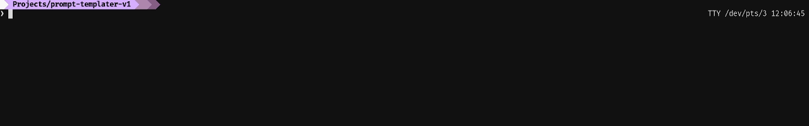
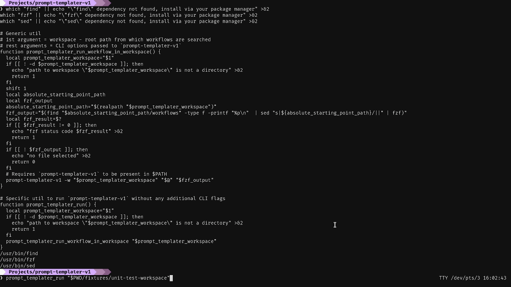
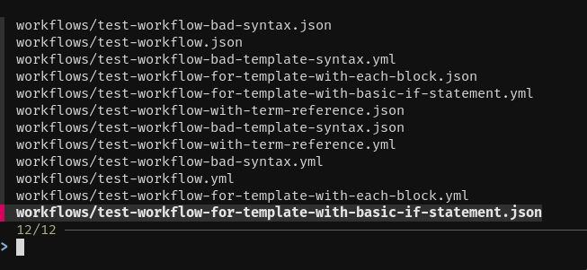

# `README.md`

`prompt-templater` is a proof-of-concept CLI template rendering util, that prefills clipboard with rendered contents. This is useful for having accessible large chunks of text that need relatively few customizations, in relatively few keystrokes. Simply think of the use-case as set of customizable shortcuts ready to paste, instead of typing words.

- [How it works?](#how-it-works)
- [How to setup?](#how-to-setup)
- [Motivation](#motivation)
- [Feature support](#feature-support)
- [Roadmap](#roadmap)
- [Anyways...](#anyways)

## How it works?



After running the command, you should automatically have following contents in your clipboard


### `prompt-templater` under the hood

`prompt-templater` works by connecting [`handlebars`](https://handlebarsjs.com/) templates with concept of workflows. Workflows are simple CLI programs / series of prompts generated from JSON / YAML config files, on top of [`inquirer` library](https://www.npmjs.com/package/inquirer). These prompts populate variables rendered by `handlebars` template.

For following command

```sh
./bin/prompt-templater -w "$PWD/fixtures/unit-test-workspace" workflows/test-workflow.yml
```

example template (available [here](./fixtures/unit-test-workspace/templates/test-template-basic.hbs))

```hbs
passed value from workflow: {{selectStep}}
```

along with example workflow (available [here](./fixtures/unit-test-workspace/workflows/test-workflow.yml))

```yaml
# Workflow file references template
# path can be relative, assuming both workflow and template are located in same workspace
templateFile: templates/test-template-basic.hbs
steps:
  - type: select
    # Defines variable name `selectStep`, that will contain picked value out of `literalValue1..3`
    id: selectStep
    message: pick an option
    valueType: string
    choices:
      type: literal
      values:
        - literalValue1
        - literalValue2
        - literalValue3
```

### Practical recommendations to make this an efficient tool

or if you want to try setting it up right away, skip to ["setup guide"](#how-to-setup)

#### recommendation \#1 - [`fzf`](https://github.com/junegunn/fzf)

Since workflow is the sole entrypoint of `prompt-templater`, that also references template to render, clearly you don't want to type workflow everytime you want to run this. [`fzf`](https://github.com/junegunn/fzf) fuzzy finder is a good tool for picking workflow to run.

You can assemble a simple workflow picker



using following snippet

```sh
# Check if executables on which bash function depends are present
function check_dependencies() {
  if ! which "find"; then
    echo "\"find\" dependency not found, install via your package manager" >&2
    return 1
  fi
  if ! which "fzf"; then
    echo "\"fzf\" dependency not found, install via your package manager" >&2
    return 1
  fi
  if ! which "sed"; then
    echo "\"sed\" dependency not found, install via your package manager" >&2
    return 1
  fi
}

check_dependencies
# Generic util
# 1st argument = workspace - root path from which workflows are searched
# rest arguments = CLI options passed to `prompt-templater`
function prompt_templater_run_workflow_in_workspace() {
  local prompt_templater_workspace="$1"
  if [[ ! -d $prompt_templater_workspace ]]; then
    echo "path to workspace \"$prompt_templater_workspace\" is not a directory" >&2
    return 1
  fi
  shift 1
  local absolute_starting_point_path
  local fzf_output
  absolute_starting_point_path="$(realpath "$prompt_templater_workspace")"
  fzf_output="$(find "$absolute_starting_point_path/workflows" -type f -printf "%p\n"  | sed "s|${absolute_starting_point_path}/||" | fzf)"
  local fzf_result=$?
  if [[ $fzf_result != 0 ]]; then
    echo "fzf status code $fzf_result" >&2
    return 1
  fi
  if [[ ! $fzf_output ]]; then
    echo "no file selected" >&2
    return 0
  fi
  # Requires `prompt-templater` to be present in $PATH
  prompt-templater -w "$prompt_templater_workspace" "$@" "$fzf_output"
}

# Specific util to run `prompt-templater` without any additional CLI flags
function prompt_templater_run() {
  local prompt_templater_workspace="$1"
  if [[ ! -d $prompt_templater_workspace ]]; then
    echo "path to workspace \"$prompt_templater_workspace\" is not a directory" >&2
    return 1
  fi
  prompt_templater_run_workflow_in_workspace "$prompt_templater_workspace"
}
```

and test with following one-liner in root folder of cloned repository

```sh
# To resolve `prompt-templater` executable path
PATH="$PATH:$PWD/bin"
prompt_templater_run "$PWD/fixtures/unit-test-workspace"
```

#### recommendation \#2 - shell alias

[`alias`](https://en.wikipedia.org/wiki/Alias_%28command%29) is strongly recommended as well; for example


using following snippet

```sh
# as for "Prompt TeMPlater Test" (uppercase denoting shortcut letters)
alias ptmpt="prompt_templater_run \"\$PWD/fixtures/unit-test-workspace\""
```

Motivation for using `alias` is ease of workspace switching rather than typing speed. As you could see in previous examples

```sh
# workspace passed as `-w` argument
prompt-templater -w "$prompt_templater_workspace" "$@" "$fzf_output"
```

Workspaces are passed as `-w` argument to `prompt-templater` executable. Workspace option `-w` is a required option. Furthermore each template and workflow belongs under a workspace.

Workspaces are are folders with following structure

```txt
.
├── templates
├── terms
└── workflows

4 directories
```

Workspace folders are considered resource containers from which resources (workflows, templates + potentially more) can be identified using relative path.


command to create workspace = TBD

For now a simple `mkdir` will suffice, as there are no further restriction on workspace, other than expecting mentioned subfolders

```sh
mkdir templates terms workflows
```

or

```sh
mkdir -p workspace/templates workspace/terms workspace/workflows
```

Organization of workspaces is subject to user decisions; workspaces can be containers per-project, or containers per-use-case, whether it's for `bash` snippets that you didn't have time to put together into maintained functionality / viable scripts,, but you need to keep it somewhere as a workaround, or for prompt crafting, for whatever is not skillified in your project using `AGENTS.md` for some reason

### Use with AI

The obvious use-case for `prompt-templater` is LLM prompt crafting, which is the main motivation why this utility came to existence in the first place.

Procedural thinking in codebases is largely achieved using LLM Skills, however `/skillify`-ing sessions / defining skill doesn't really fill the gap towards one-shotting UX with LLMs. Use of skills still requires articulating a lot of supplementary prompt text. Fuzzy finder with a few keypresses, gets closer to the almost-deterministic feel of getting things done with AI.

## How to setup?

<span style="color: #FFD700;">⚠️</span> Heavy PoC - naturally untested outside of my Linux workstation

### Dependencies

- [`bun`](https://bun.sh/)
- [`fzf`](https://github.com/junegunn/fzf) (recommended)

### 1. `git clone`

```sh
# Check if executables on which bash function depends are present
function check_dependencies() {
  if ! which "bun"; then
    echo "\"bun\" dependency not found, install" >&2
    return 1
  fi
  if ! which "find"; then
    echo "\"find\" dependency not found, install via your package manager" >&2
    return 1
  fi
  if ! which "fzf"; then
    echo "\"fzf\" dependency not found, install via your package manager" >&2
    return 1
  fi
  if ! which "sed"; then
    echo "\"sed\" dependency not found, install via your package manager" >&2
    return 1
  fi
}

function setup() {
  # Check deps and fail if there's a dependency missing
  check_dependencies || return $?
  git clone "https://codeberg.org/koniferous22/prompt-templater.git"
}

setup
```

### 2. Configure shell utils

Define `prompt-templater` related functions in your `.bashrc` / `.zshrc`

Note for `nushell` users - sadly didn't have time to write `nushell` equivalent :(

```sh
# Generic util
# 1st argument = workspace - root path from which workflows are searched
# rest arguments = CLI options passed to `prompt-templater`
function prompt_templater_run_workflow_in_workspace() {
  local prompt_templater_workspace="$1"
  if [[ ! -d $prompt_templater_workspace ]]; then
    echo "path to workspace \"$prompt_templater_workspace\" is not a directory" >&2
    return 1
  fi
  shift 1
  local absolute_starting_point_path
  local fzf_output
  absolute_starting_point_path="$(realpath "$prompt_templater_workspace")"
  fzf_output="$(find "$absolute_starting_point_path/workflows" -type f -printf "%p\n"  | sed "s|${absolute_starting_point_path}/||" | fzf)"
  local fzf_result=$?
  if [[ $fzf_result != 0 ]]; then
    echo "fzf status code $fzf_result" >&2
    return 1
  fi
  if [[ ! $fzf_output ]]; then
    echo "no file selected" >&2
    return 0
  fi
  # Requires `prompt-templater` to be present in $PATH
  prompt-templater -w "$prompt_templater_workspace" "$@" "$fzf_output"
}

# Specific util to run `prompt-templater` without any additional CLI flags
function prompt_templater_run() {
  local prompt_templater_workspace="$1"
  if [[ ! -d $prompt_templater_workspace ]]; then
    echo "path to workspace \"$prompt_templater_workspace\" is not a directory" >&2
    return 1
  fi
  prompt_templater_run_workflow_in_workspace "$prompt_templater_workspace"
}

# Runs `prompt-templater` with additional "-u" flag
function prompt_templater_run_unsafe() {
  local prompt_templater_workspace="$1"
  if [[ ! -d $prompt_templater_workspace ]]; then
    echo "path to workspace \"$prompt_templater_workspace\" is not a directory" >&2
    return 1
  fi
  prompt_templater_run_workflow_in_workspace "$prompt_templater_workspace" "-u"
}
```

### 3. Create workspaces in your FS

```sh
mkdir templates terms workflows
```

or

```sh
# ⚠️ make sure to reconfigure
mkdir -p /my/path/to/prompt-templater/workspace1/templates /my/path/to/prompt-templater/workspace1/terms /my/path/to/prompt-templater/workspace1/workflows
```

### 4. Define workspace env variables and `alias`es

#### workspace env variables

<span style="color: #FFD700;">⚠️</span> make sure to reconfigure

```sh
# either `~/.bash_profile`, or `.zshenv
# ⚠️ make sure to reconfigure
PROMPT_TEMPLATER_WORKSPACE1=/my/path/to/prompt-templater/workspace1
# ⚠️ make sure to reconfigure
PROMPT_TEMPLATER_WORKSPACE2=/my/path/to/prompt-templater/workspace2
```

#### `alias`es

```sh
# either `~/.bashrc`, or `.zshrc
ptmpw1="prompt_templater_run \"\$PROMPT_TEMPLATER_WORKSPACE1\""
ptmpw2="prompt_templater_run \"\$PROMPT_TEMPLATER_WORKSPACE2\""
# unsafe variants
ptmpwu1="prompt_templater_run_unsafe \"\$PROMPT_TEMPLATER_WORKSPACE1\""
ptmpwu2="prompt_templater_run_unsafe \"\$PROMPT_TEMPLATER_WORKSPACE2\""
```

## Motivation

[(skip to shorter version)](#shorter-version)

### Longer version (goes a off tangent, so naturally don't read it, unless you have no other choice)

`prompt-templater` at the present moment can assist in few use cases with respect to AI, due to being in proof-of-concept stage. The usefulness is limited namely through limited workflow syntax, hopefully [it gets better soon](#roadmap). Neverthless AI is the primary motivation for this project, especially the area of orchestrating complex tasks. Tasks with desired outcome, should have short, or preferably no [agentic loop](https://en.wikipedia.org/wiki/AI_agent)s. I've put together a few reasons why, however don't expect me to lead hour-long debates defending the reasons. Or in case you do expect me to defend stated reasons for some reason, don't expect prompt responses on stated topics, as I got shit to do.

#### Reason \#1 - Risk of poor outcomes of agentic detours, or in worse case improvisation (⚠ text in this section contains bias, and if that weren't enough, it also contains AI pessimist ramblings; naturally read only at your own risk, you've been warned)

The AI output often feels like random noise. Obviously LLMs work smoothly when user has finetuned nuanced instructions how AI should approach whatever objective you specified, however unless you specify this additional context, whether it's thorough prompt-crafting, or features / plugins such as `/skillify`, often you end up rolling the dice (metaphorically). You specify skill trigger logic, yet agentic loop doesn't detect it and resorts to 2 minute detour. It's a strange paradox, that agentic loop is supposed to be reactive in the sense, that you throw pre-trained agent into environment, where the agent registers, interprets, understands and eventually acts within the environment, continues the loop of registering, interpreting and understanding, until the agent evaluates that the stated objective is completed. A beautiful theory, however often it ends up being the exact opposite, that the human who delegated task to AI agent is actually the one subjected to the human loop, where the human loop is process of iterative readjusting of the agent to retry task completion, but this time properly, with actually desired outcome. It's a strange world where nuances of human craft have been thrown away, so that you can get things done by interacting with a clanker.

While LLMs are great from perspective of metrics, such as accuracy, or whatever the fuck do AI companies consider their primary driver metric of their [pre-training and training procedures](https://en.wikipedia.org/wiki/Training_of_large_language_models#Pretraining). I find large-language models poor guarantee of stability to regularly rely on, compared to discrete concepts, that operate on 1s and 0s - i.e. compilers, operating systems, math, logic, scientific reasoning etc.

Random noise is a feature, not a bug, otherwise AI companies wouldn't have to transparently put out following statements.

[](https://openai.com/policies/terms-of-use/)

The notion of acceptable entropy is an axiom of [machine learning](https://en.wikipedia.org/wiki/Machine_learning) as a research field. Consequentially, any company in the machine learning field, will engage in two-faced behaviour - [hyperstitioning](https://en.wikipedia.org/wiki/Hyperstition) singularity, while at the same time distancing themselves from accountability of model output.

To continue on AI-pessimist note, interacting with AI, 90% of time feels ok without issue. However then there are the remaining outlier cases, where the interaction causes frustration, or potentially visible human cortisol spikes. Such interaction outcomes sadly keep our understanding, or at very least my personal understanding of artificial intelligence as a tool shrouded by its unpredictability. On personal level, AI just reminds me of old-school engineering terms such as [GIGO](https://en.wikipedia.org/wiki/Garbage_in,_garbage_out) (Garbage-in garbage-out), which is a nice phrase for programs producing unusable output, except the end user is obviously not the one providing the shitty input.

But above all else, building things solely through agentic improvisation, while interactive aspect of human experience gets flatlined is simply not fun, I would argue even that it's the exact opposite; it's just annoying. I would also suggest, that drawbacks from excessive reliance on LLMs, such as losing touch with technique of how to get things done from details to abstraction, excessive cognitive offload, or neglecting articulation of ideas, could be linked to phenomena of AI psychosis. But that's just speculative, and if I continued on this tangent, this paragraph would never end, so maybe another time.

#### Reason \#2 - Risk of input context explosion

By letting agent rely on findings from agentic loop, evaluation can lead to excessive sidetracks, and gathering excessively large input context. While such task delegation to agentic loop gets the job done, the achieved result could be costly at least from perspective of input tokens and even potentially surpass one-shotting, that at very least doesn't abandon nuance.

While this is a valid concern, I believe it's secondary. First of all, assuming somebody ever reads this, I have to naturally count on the fact that reader might be tokenmaxxer, therefore particular issue of LLM billing for some people might not be relevant. Matter of fact, I think it's quite unlikely that software engineers care either about environment, or their LLM billing dashboards, especially in cases when their employer pays for the use.

To conclude the point of excessively large input context resulting from vague prompts and agentic loops, I do not have any evidence for the stated claim about agentic detours being costlier, nor am I willing to do any research to support this claim, so in an unlikely case it happens to be an authoritative source for something, just know that it comes from gut feeling and opinion.

#### Orchestration, a.k.a putting the pieces together

One-shotting solves many issues of agentic loop - detours, potential improvisation. One-shotting works by providing detailed directions, how agent can accomplish the stated objective, by thoroughly articulating all relevant context. There are obvious drawbacks of one-shotting

- cost of time invested in crafting the one-shot macro for complex scenarios + (potentially) testing
- a lot of complex crafted prompts are unlikely to be used ever again
  - i.e. restricted applicability, due to being poor investment of human time
    - as a consequence there are instances, where it's better strategy to be naive and trust the LLM, rather than putting excessive emphasis on details that gets put to use once in lifetime
- nobody has time for writing (or reading) essay these days

`prompt-templater` conceptually makes one-shotting more usable, by accessing large chunks of customizable text with few keystrokes. LLM skills also fill vacuum of many drawbacks of one-shotting, at least in area of software projects. LLM skills luckily succeed in making software projects procedural + they are great for markdown organization. Where LLM skills and agentic loop falls short is "orchestration"

Let's assume following conceptual model, that assumes following vaguely stated axioms

- 1 - You've got a problem to solve
- 2 - problem is decomposable to subproblems. Through first [principle analysis](https://en.wikipedia.org/wiki/First_principle), you decompose the problem to hierarchy of subproblems / [tree](<https://en.wikipedia.org/wiki/Tree_(abstract_data_type)>) data structure / [directed acyclic graph](https://en.wikipedia.org/wiki/Directed_acyclic_graph) / _some similar model_
- 3 - for each atomic problem you have predefined skill
  - i.e. you can tackle individual small problem with a few words typed as prompt - `/skill1 solve the 1st atomic problem`
- 4 - Skill can be automatically invoked in agentic loop, as skill specifies its trigger mechanisms, that can be vague or specific

I could think of following approaches

- a - rely on agentic loop with skills defined with vague trigger mechanism - i.e. let agent decide what skill is used under what conditions. This practically results in detours or improvisation, so the natural concept of this approach is acceptance of submission to a human loop - i.e. for each problem that you solve, resort to solving it by painful clanker communication, which consists of readjustments by typing 5, or 10, or 20, or more short prompts (modern form of torture if you ask me, ngl should be banned under geneve convention)
- b - rely on agentic loop with skills defined with detailed / specific skill trigger mechanisms - i.e. enumerate concrete instances when a skill should be invoked within agentic loop
  - this approach scales poorly. In large codebases you typically deal with large amount of use-cases, where listing them one-by-one along with potential conditions is unreasonable to maintain.
  - Also in practice this is limited by [agent skills standards](https://agentskills.io/specification) 1024 character limits
- c - specify objective through longer prompt listing all the skils with user user inputs
  - i.e. solve higher-order problems by enumerating underlying atomic problems, and for each atomic problem, solve by using corresponding skills roughly in following manner

    ```txt
    /skill1 solve the 1st atomic problem
    /skill2 solve the 2nd atomic problem
    ```

  - `prompt-templater` could be applicable here as set of presets for higher-order problems
  - <span style="color: #FFD700;">⚠️</span> - this approach is also subjected to skill limits imposed by products such as "claude code" etc.
    - [Example quota](https://platform.claude.com/docs/en/build-with-claude/skills-guide) (hopefully the link is not dead)
- d - meta-skills
  - Define skills on top of skills
  - For instance assume that you can define skill that reuses other skills
    - example skill

      ```md
      ## Step 3: Code review

      Call the Skill tool with `code-review`.
      ```

  - In case of "meta-skill" - i.e. skills reusing other skills you potentially deal with space explosion. If the cardinality of set of skills is `n`, then set of all subsets is `2^n` (i.e. exponential)
    - i.e. if you open up area of skills, then you might end up with way too many skills
    - Personally, I highly doubt that it's a good idea to put that amount of skills (`2^n`) into software projects

Assuming we discount solutions a / b, for sake of distaste of non-determinism, to define universal solution that user can rely on without risking detours or improvisation, one eventually falls into area of combinatorics. This happens due to higher order problems that consist of subproblems for which LLM skill is articulated, require combinations of skills. What better way to navigate large exponential space, than to maintain stash of cached snippets, accessible in a few keystrokes?

Anyways, to conclude this rant, the area of orchestrating solutions for higher-order problems is so catastrophic at least in terms of UX, that it resulted in personal endeavor to put this piece of crap software together, regardless if I'm the sole autistic user of it or not. Enjoy ;)

### Shorter version

take a look at these two images, and think which one of these two interfaces is faster, more interactive and most importantly doesn't require unreasonable amount of mental gymnastics / instructions to achieve the desired result

<p align="center">
  
  &nbsp;&nbsp;
  
</p>

## Feature support

<span style="color: #FFD700;">⚠️</span> this section is work in progress and potentially subject to frequent changes

### workflow syntax

TBD

### `handlebars` template syntax

`prompt-templater` uses restricted `handlebars` template syntax

Following `handlebars` features are not supported

- [`decorators`](https://handlebarsjs.com/api-reference/runtime.html#handlebars-registerdecorator-name-helper-deprecated)
- [`partials`](https://handlebarsjs.com/guide/partials.html)

unsupported features are defined with respect to codebase [here](./src/constants/enums/templateEngines/handlebars/ast.ts)

### [`handlebars` block helpers](https://handlebarsjs.com/guide/builtin-helpers.html)

Block syntax, for instance

```hbs
{{#if 0 includeZero=true}}
  <h1>Does render</h1>
{{/if}}
```

defines block keywords (in this case `if`, in `#if` block)

following block helpers are supported

- `with`
- `each`
- `if`
- `unless`
- `ifEquals`
- `unlessEquals`

This feature is expected to improve over time

Supported block helpers are defined [here](./src/constants/enums/templateEngines/handlebars/ast.ts)

### Template validation against workflow

Workflow specification validated against template variable references retrieved from parsed `handlebars` AST, i.e. unmatched variables should return errors


This validation can be skipped by passing `--skip-template-validation` CLI option

### `-u/--unsafe-render` CLI option

TBD

## Roadmap

- Docs improvement - document workflow syntax
- lazy-loading + dynamic terms
- nested workflows
- refactor to some better runtime than `bun` (chosen for proof-of-concept purposes)
- `vim` keybindings + probably other session engines than `inquirer`
- \+ probably more stuff..

## Anyways...

Made with power of friendship and [good](https://www.youtube.com/watch?v=ISToCH2STF0) [vibez](https://www.youtube.com/watch?v=husiHTQptvE)

Feel free to submit feature request and all that stuff (although I assume that's quite naive from me to expect :D :D)

Also shoutout to Simba from Lion King
